<div align="center">

<picture>
  <source media="(prefers-color-scheme: dark)" srcset="docs/assets/hero-dark.webp">
  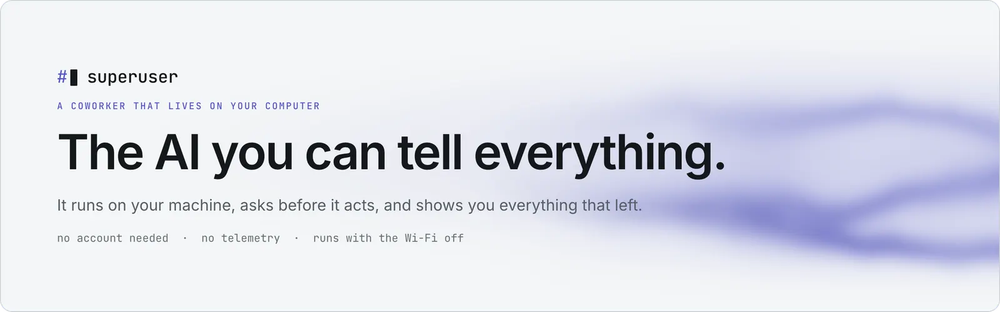
</picture>

<br/>
<br/>

<a href="https://aniketshukla1.github.io/superuser/assistants.mp4"></a>
&nbsp;
<a href="#quickstart"></a>
&nbsp;
<a href="https://aniketshukla1.github.io/superuser/"></a>

<br/>
<br/>

<a href="https://github.com/aniketshukla1/superuser/actions/workflows/ci.yml"></a>
<a href="LICENSE"></a>


<sub><a href="#hand-over-the-whole-job">Assistants</a> &nbsp;·&nbsp; <a href="#features">Features</a> &nbsp;·&nbsp; <a href="#private-is-a-setting-you-can-check">Privacy</a> &nbsp;·&nbsp; <a href="#under-the-hood">Under the hood</a> &nbsp;·&nbsp; <a href="#quickstart">Quickstart</a> &nbsp;·&nbsp; <a href="#faq">FAQ</a> &nbsp;·&nbsp; <a href="CONTRIBUTING.md">Contributing</a></sub>

</div>

<br/>

<a href="https://aniketshukla1.github.io/superuser/assistants.mp4">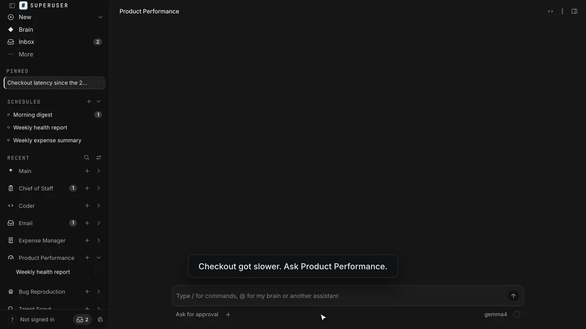</a>

<p align="center"><sub>Six assistants, each doing a whole job. The real app, over invented demo data. &nbsp;<a href="https://aniketshukla1.github.io/superuser/assistants.mp4">▶ Watch with sound (24 s)</a></sub></p>

<br/>

## Superuser does real work across your apps, on your own computer

An AI coworker for your **mail, calendar, chat, code, metrics and the web**. Pick an assistant, hand it a job, and get back finished work: the steps it took, the numbers behind them, and the facts kept apart from the guesses. Anything it wants to send, run or change waits for your yes.

> [!IMPORTANT]
> Other assistants keep what you tell them on their servers. **Superuser keeps it on your disk, and lists every request that leaves.**

Run it entirely on your own hardware with a local model, or point it at Claude, GPT or Gemini when you want more power. No account needed and no telemetry. Everything works with nothing of ours in the middle.

|        | Step | Example |
| ------ | ---- | ------- |
| **01** | **Connect** | Your mail, calendar, Slack, GitHub, Jira, Prometheus, or nothing at all. Keys are stored encrypted on your Mac. |
| **02** | **Ask** | *"Checkout got slower since yesterday's release. Find where, with evidence."* One of 20 assistants takes it from there and shows every step. |
| **03** | **Approve** | Messages, commands and changes wait in your Inbox. Every request that left your Mac is on the record. |

<br/>

## Hand over the whole job

Six assistants that each own a job end to end. The part that has to be right is done by code, not by the model:

| Assistant | The job | What holds the line |
| --- | --- | --- |
| **Email Assistant** | Answers mail from senders you allow | Every reply is a draft in your Inbox. Nothing is sent without your yes. |
| **Expense Manager** | Logs receipts from email, summarises the week | The totals are computed, and each one lists the receipts it adds up. |
| **Chief of Staff** | What came in since yesterday, mapped to your priorities | It can't send a message or move a meeting. It has no tool that could. |
| **Bug Reproduction** | Reproduces a bug report with steps, screenshots and a test case | Its browser opens your staging site and nothing else, so production data never reaches it. |
| **Product Performance** | Finds where a slowdown is, from your Prometheus | Every series is compared before and after the change, in code. Only a clear shift is called a hotspot. |
| **Talent Scout** | Finds candidates who meet the must-haves, and drafts outreach | Your ATS export is checked in code, so nobody already in it makes the list. Nobody is contacted. |

<br/>

<div align="center">
<table>
  <tr>
    <td align="center"><strong>Thinks<br/>with</strong></td>
    <td align="center"><br/><sub>Ollama</sub></td>
    <td align="center"><br/><sub>Claude</sub></td>
    <td align="center"><br/><sub>Gemini</sub></td>
    <td align="center"><br/><sub>Mistral</sub></td>
    <td align="center"><br/><sub>DeepSeek</sub></td>
    <td align="center"><sub>OpenAI · Grok<br/>Groq · Together</sub></td>
    <td align="center"><sub>Fireworks<br/>OpenCode Zen</sub></td>
    <td align="center"><sub>your ChatGPT<br/>or Claude plan</sub></td>
  </tr>
  <tr>
    <td align="center"><strong>Works<br/>in</strong></td>
    <td align="center"><br/><sub>Gmail</sub></td>
    <td align="center"><br/><sub>Calendar</sub></td>
    <td align="center"><br/><sub>GitHub</sub></td>
    <td align="center"><br/><sub>Jira</sub></td>
    <td align="center"><br/><sub>Linear</sub></td>
    <td align="center"><br/><sub>Notion</sub></td>
    <td align="center"><br/><sub>Prometheus</sub></td>
    <td align="center"><sub>Slack · Outlook<br/>+ 28 more · MCP</sub></td>
  </tr>
</table>

<em>Any model, including a local one or any OpenAI-compatible API. Your apps, your Mac, your rules.</em>

</div>

<br/>

## Problems Superuser solves

| Without Superuser | With Superuser |
| --- | --- |
| ❌ Every morning you paste the same context into a chatbot, because it forgot. | ✅ It already read it: memory built from your mail, calendar, repos and notes, kept on your disk. |
| ❌ An "agent" sent an email you never saw. | ✅ Every message waits in your **Inbox**, showing exactly what would leave and where it would go. |
| ❌ A privacy policy says your data is safe. You can't check. | ✅ The **Network** page lists every host contacted and why. Turn on local-only mode and watch the refusals. |
| ❌ The assistant cites a file it never opened, or charts numbers it made up. | ✅ **Gates** check paths, links and chart sources against what the run actually read, and send invented ones back. |
| ❌ You wrote "never touch `.env`" in a prompt and hoped. | ✅ **Boundaries** are rules checked in code before every action. Deny wins; a broken rule refuses. |
| ❌ Checkout got slower and you're clicking through dashboards. | ✅ **Product Performance** compares every series before and after the release and writes up the hotspot, with links. |
| ❌ Sourcing turns up people who are already in your ATS, and you email them twice. | ✅ **Talent Scout** checks every candidate against your ATS export in code, and leaves the outreach as drafts you send. |

<br/>

## Features

<table>
<tr>
<td width="33%" valign="top">
<h3>🤖 Any model, including your own</h3>
Run on your own hardware with Ollama, or use Claude, GPT, Gemini and 10 more providers, your ChatGPT or Claude plan among them. Switching is a dropdown, and the local option needs no key.
</td>
<td width="33%" valign="top">
<h3>🧑‍💼 20 assistants, each different</h3>
Chief of Staff, Email, Product Performance, Talent Scout, Coder, Security, Finance and more, each with its own instructions, tools, skills and model. Create your own in the app.
</td>
<td width="33%" valign="top">
<h3>🔌 Your actual tools</h3>
37 connectors with real tools (Gmail, Slack, GitHub, Jira, Notion, Prometheus, Stripe, HubSpot…) plus any MCP server. Real accounts doing real work.
</td>
</tr>
<tr>
<td valign="top">
<h3>✋ Asks before it acts</h3>
Every message, command and change is shown before it happens. Allow it once, always for that target, or let a routine run unattended within limits you set.
</td>
<td valign="top">
<h3>🛡️ Boundaries you can read</h3>
"Never send messages." "Don't touch secret files." Rules checked before every action: deny wins, and a rule with a typo refuses rather than allows. Each preset says what it costs.
</td>
<td valign="top">
<h3>🔒 Private, and you can check</h3>
One chokepoint for every outbound request, enforced by a test. The Network page lists each host and why. Local-only mode refuses everything else, on the record.
</td>
</tr>
<tr>
<td valign="top">
<h3>🧠 Memory you can read</h3>
What it knows is Obsidian-compatible markdown on your disk, with where each fact came from. Open it, edit it, delete it. Its history is a git repository you can read.
</td>
<td valign="top">
<h3>⏰ Works while you're away</h3>
Routines on a schedule (a weekday digest, a Monday health report) and watches that tell you when something changes. Results wait for you with the evidence.
</td>
<td valign="top">
<h3>📊 Evidence, not vibes</h3>
Charts drawn from data it actually read, with the source on every chart. Gates catch invented file paths, links and numbers before they reach you.
</td>
</tr>
</table>

**Also in the box:** voice dictation that runs on your Mac (whisper.cpp) · a browser of its own for each assistant, which hands you the wheel at sign-in pages · talk to your assistants from Slack, Telegram or email · assistants that delegate to each other · 42 built-in skills (playbooks for code review, budgets, database migrations, sourcing, interview loops…) · an OpenAI-compatible API on `127.0.0.1` so your other tools can hand it work.

<br/>

## A closer look

<table>
<tr>
<td width="50%">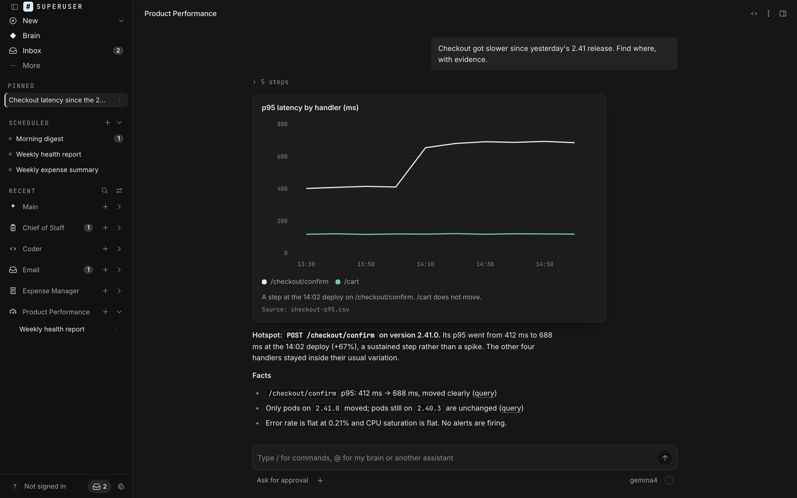<p align="center"><sub><b>Answers with evidence</b>: the steps, a chart with its source, facts apart from guesses</sub></p></td>
<td width="50%">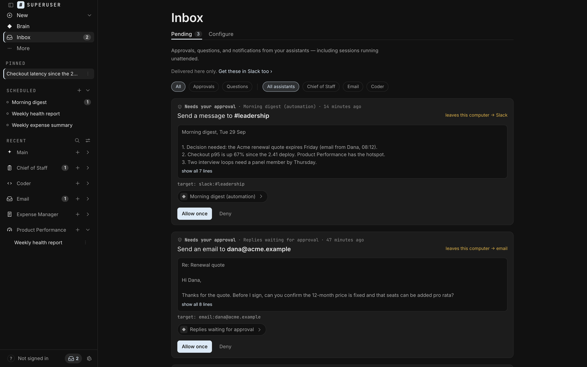<p align="center"><sub><b>Inbox</b>: each message waits for your yes, showing exactly what would leave</sub></p></td>
</tr>
<tr>
<td width="50%">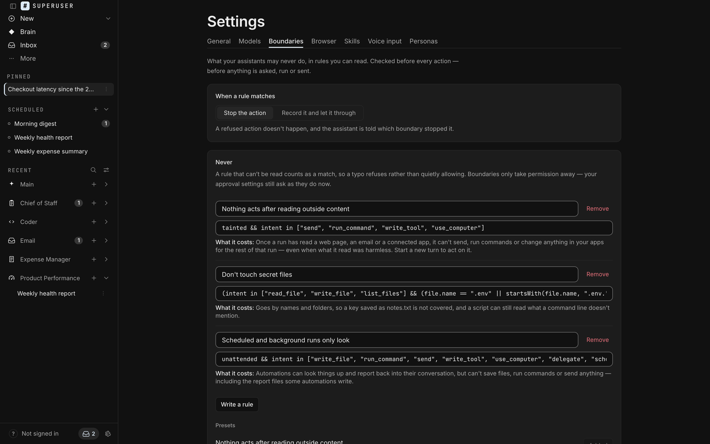<p align="center"><sub><b>Boundaries</b>: your rules, checked before every action</sub></p></td>
<td width="50%">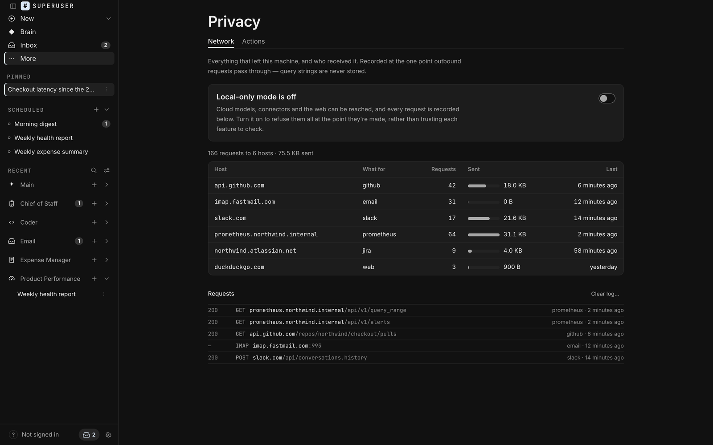<p align="center"><sub><b>Network</b>: everything that left this machine, and who received it</sub></p></td>
</tr>
<tr>
<td width="50%">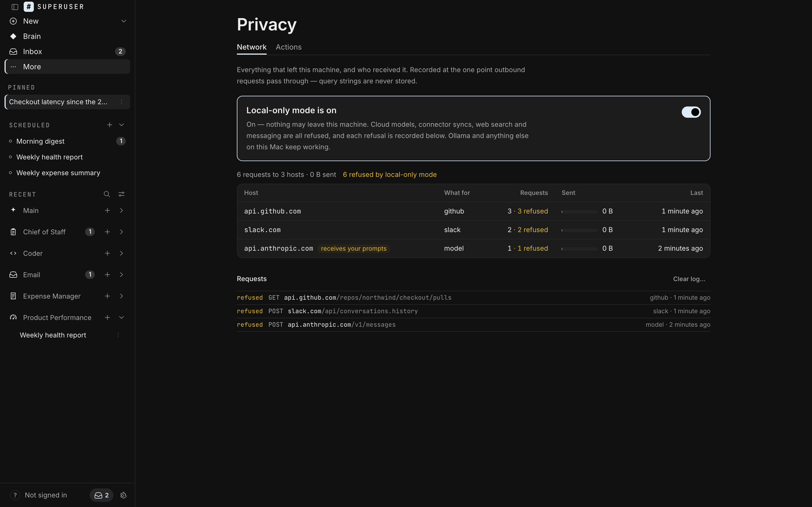<p align="center"><sub><b>Local-only mode</b>: refused where it would have left, and written down</sub></p></td>
<td width="50%">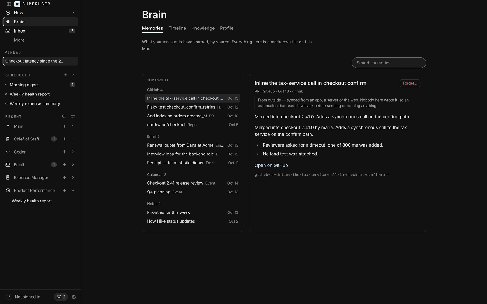<p align="center"><sub><b>Brain</b>: what it knows, as markdown files, with where each came from</sub></p></td>
</tr>
<tr>
<td width="50%">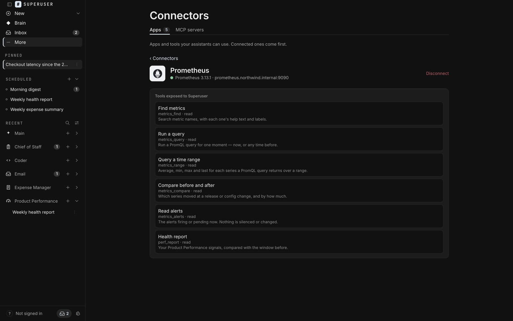<p align="center"><sub><b>Connectors</b>: exactly which tools an assistant gets from each app</sub></p></td>
<td width="50%">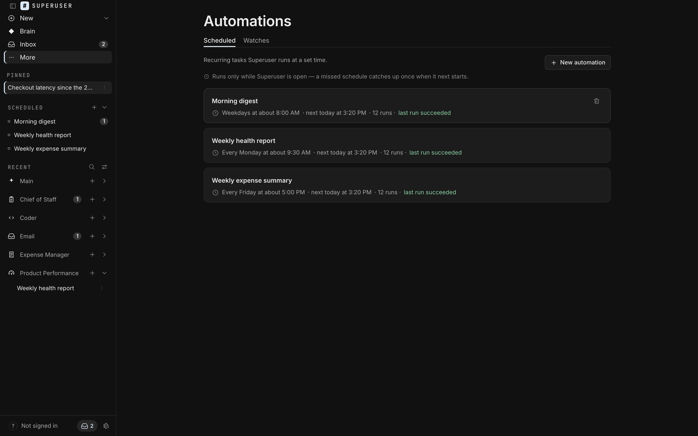<p align="center"><sub><b>Routines</b>: scheduled work that reports back</sub></p></td>
</tr>
</table>

<details>
<summary><b>Play the tour</b> (an animated walk through the screens above)</summary>
<br/>
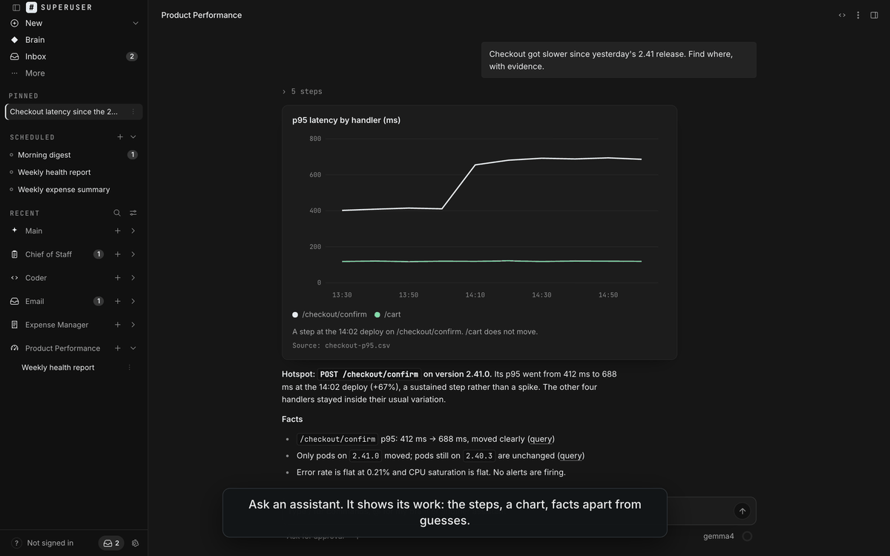
</details>

<sub>Screenshots are the real interface, running on invented demo data. Regenerate them with <a href="CONTRIBUTING.md#regenerating-the-readme-images"><code>scripts/readme-assets.py</code></a>.</sub>

<br/>

## Private is a setting you can check

"We take your privacy seriously" is a sentence. These are mechanisms, and each one is in the source for you to read:

| Claim | How it's enforced | See it yourself |
| --- | --- | --- |
| **Every request that leaves is recorded** | One chokepoint builds every HTTP client ([`core/egress.rs`](src-tauri/src/core/egress.rs)). A test fails if code creates one anywhere else. Mail protocols declare themselves the same way. | Privacy ▸ Network |
| **Local-only means local-only** | Refused at that chokepoint, not feature by feature: models, connectors, web search, messaging and the assistants' browser. | Flip the switch, then read the refusals |
| **No telemetry** | There is nothing to switch off. Every outbound purpose is named in the source, and none of them is analytics or an update check. | `git grep 'egress::client('` |
| **Your rules are enforced, not suggested** | One gateway ([`core/gateway.rs`](src-tauri/src/core/gateway.rs)) checks your boundaries before every tool call and writes the decision down before anything runs. | Settings ▸ Boundaries |
| **A trail you can trust** | An append-only log where each row carries the hash of the one before, so an edit or a deletion shows. Anything shaped like a credential is scrubbed first. | Privacy ▸ Actions |
| **Keys stay locked** | Credentials are encrypted at rest with ChaCha20-Poly1305 and mirrored to the macOS keychain. | [`core/secrets.rs`](src-tauri/src/core/secrets.rs) |
| **Outside content is data** | Anything read from the web, an email or a connected app marks the run. One preset stops a marked run from sending, running commands or changing things. | Preset: *Nothing acts after reading outside content* |

<br/>

## How good are local models at this?

Measured, not guessed. The same 20 agent tasks (read, write, edit, shell, recovery, honesty, tool use), three runs each, through Ollama:

| Model | Tasks passed | Cost |
| --- | --- | --- |
| `gemma4:12b` | **54 / 60** | $0 |
| `qwen2.5:7b-instruct` | 44 / 60 | $0 |
| `llama3.2` (3B) | 29 / 60 | $0 |

Per-task results are in [docs/harness/HARNESS-SCOREBOARD.md](docs/harness/HARNESS-SCOREBOARD.md), and the harness itself is [`src-tauri/src/harness_eval.rs`](src-tauri/src/harness_eval.rs). For the longest multi-step jobs a frontier cloud model is still stronger, and you can choose one per assistant.

<br/>

## Under the hood

<picture>
  <source media="(prefers-color-scheme: dark)" srcset="docs/assets/architecture-dark.png">
  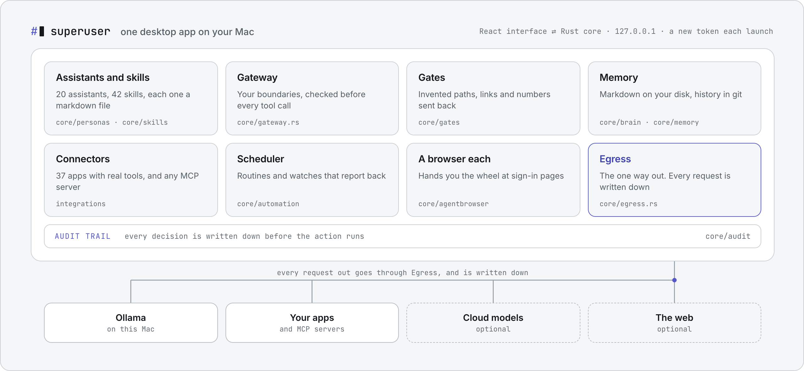
</picture>

<picture>
  <source media="(prefers-color-scheme: dark)" srcset="docs/assets/stats-dark.png">
  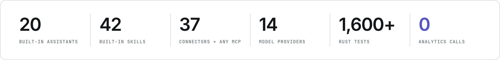
</picture>

A Rust core (Tauri 2) with a React interface. The core serves the interface over HTTP and WebSocket on `127.0.0.1` only, and every request needs a token that changes each launch. Each part in the drawing names the folder it lives in under `src-tauri/src`.

<br/>

## The assistants

Each assistant is one markdown file: a short header naming its tools and skills, and a body that is its instructions. Pick one per conversation, or create your own in the app.

<details>
<summary><b>All 20 built-in assistants</b></summary>

| Assistant | What it does |
| --- | --- |
| **Main Assistant** | Get things done — research, drafts, and analysis |
| **Chief of Staff** | Reads what came in since yesterday and tells you what matters |
| **Email Assistant** | Reads your email and drafts the replies you approve |
| **Product Performance** | Investigates a slowdown in your metrics — the hotspot, the evidence, and links |
| **Bug Reproduction** | Reproduces a bug report on staging, with exact steps and a test case |
| **Talent Scout** | Finds candidates who meet the must-haves — none already in your ATS — with outreach drafts |
| **Coder** | Work in a codebase — edit, run, and ship |
| **Data Analyst** | Answer the question that was asked, and show the numbers that complicate it |
| **Finance Analyst** | Say where the money actually went, and when it runs out |
| **Expense Manager** | Logs receipts from your email and builds summaries that add up |
| **Ops Assistant** | Incidents and runbooks — logs, metrics, infrastructure |
| **Security Assistant** | Security problems found and fixed — scan, triage, PR |
| **Dependency Audit Assistant** | Risky dependencies — audit, smallest upgrades, PRs |
| **Cloud Posture Assistant** | Review Terraform and cloud config — read-only, evidence first |
| **QA Analyst** | Find what breaks before someone else does, and say what you didn't check |
| **Product Manager** | Specify it so it can be built and tested without a meeting |
| **Team Lead** | Break work down, hand it out, check it came back right |
| **Technical Writer** | Documentation written from the code, and followed before it ships |
| **Customer Support** | Solve the problem behind the ticket, and answer even when the answer is no |
| **HR Partner** | Describe the job, run the same process for everyone, and write it down |

</details>

<details>
<summary><b>All 37 connectors</b></summary>

| Area | Connectors |
| --- | --- |
| Messaging | Slack, Telegram, Discord, WhatsApp |
| Email and calendar | Email (IMAP), Gmail, Outlook, Google Calendar |
| Files and docs | Google Drive, Dropbox, Box, Notion, Confluence, Docusign |
| Engineering | GitHub, GitLab, Jira, Linear, Asana, ClickUp |
| Operations | PagerDuty, Prometheus, Datadog |
| Sales and support | HubSpot, Salesforce, Attio, Close, Apollo.io, Hunter, Zendesk |
| Finance | Stripe, QuickBooks |
| Design | Figma, Canva |
| Analytics | PostHog, Mixpanel, Amplitude |

Plus any [MCP](https://modelcontextprotocol.io) server you run or point it at. Connections use your own credentials, stored encrypted on your Mac, with no broker in between. Superuser Cloud, coming next, adds optional one-click sign-in.

</details>

<br/>

## What Superuser is not

| | |
| --- | --- |
| **Not a cloud service.** | It's a program on your Mac, and your data stays in a folder you can open. Superuser Cloud, coming next, is optional: it only brokers one-click connections, and nothing needs it. |
| **Not a chat window.** | It works inside your apps and hands back finished work, not a transcript. |
| **Not autonomous by default.** | It asks before sending, running or changing anything, until you decide otherwise. |
| **Not an integration count.** | 37 connectors built in, each with real tools, plus any MCP server. Depth over a long logo wall. |
| **Not cross-platform yet.** | macOS 13 or later today. Windows and Linux builds are not tested. |

<br/>

## Quickstart

**You need:** macOS 13 or later, the Xcode command line tools (`xcode-select --install`), [Rust](https://rustup.rs), [Node.js](https://nodejs.org) 20 or later, and CMake (`brew install cmake`, for on-device voice).

```bash
git clone https://github.com/aniketshukla1/superuser.git
cd superuser
npm install                     # the Tauri command line
npm --prefix surfaces/gui ci    # the interface
npm run app                     # build the Rust core and open the app
```

The first build compiles the Rust core, including whisper.cpp, so it takes several minutes and a few GB of disk. Later starts are quick. On first launch, setup asks which model to use and which apps to connect; both can wait.

**Fully local, no keys:**

```bash
brew install ollama
brew services start ollama
ollama pull gemma4:12b          # or qwen2.5:7b-instruct on a smaller machine
```

Then choose Ollama in setup, or later in Settings ▸ Models. Turn on local-only mode (sidebar ▸ More ▸ Privacy) and nothing leaves your Mac.

<details>
<summary><b>Build a standalone app</b></summary>

```bash
npm run build     # → src-tauri/target/release/bundle/macos/Superuser.app
```

The build is not signed. The first time you open it, right-click the app and choose **Open**.
</details>

<br/>

## Use it from your other tools

Superuser serves an OpenAI-compatible API on `127.0.0.1`. Your assistants are the models:

```bash
PORT=8765   # the app's port; if 8765 is taken it picks another and writes that token instead
TOKEN=$(cat "$HOME/Library/Application Support/ai.superuser.app/sidecar-$PORT.token")

curl -s http://127.0.0.1:$PORT/v1/chat/completions \
  -H "Authorization: Bearer $TOKEN" -H "Content-Type: application/json" \
  -d '{"model": "chief", "messages": [{"role": "user", "content": "What needs my attention today?"}]}'
```

`GET /v1/models` lists the assistants you can name. Streaming is not supported yet, and a request for it is refused rather than quietly answered in one piece.

<br/>

## Handy shortcuts

| Do this | Press | | Do this | Press |
|---|---|---|---|---|
| New conversation | <kbd>⌘</kbd><kbd>N</kbd> | | Search conversations | <kbd>⌘</kbd><kbd>K</kbd> |
| Show or hide the sidebar | <kbd>⌘</kbd><kbd>B</kbd> | | Settings | <kbd>⌘</kbd><kbd>,</kbd> |
| Answer a question card | <kbd>1</kbd> – <kbd>4</kbd> | | Send / new line | <kbd>↩</kbd> / <kbd>⇧</kbd><kbd>↩</kbd> |

<br/>

## FAQ

<details>
<summary><b>Does my data leave my computer?</b></summary>
<br/>
Only when you choose a cloud model or connect an app, and then only to that provider or app. Each request is listed on the Network page with its host and what it was for. With Ollama and local-only mode on, nothing leaves, and the refusals show up in the same list.
</details>

<details>
<summary><b>Do I need an account or an API key?</b></summary>
<br/>
No. With Ollama you need no key at all, and a cloud model needs only that provider's key, stored encrypted on your Mac. Superuser Cloud, coming next, is an optional account for one-click connections; everything in this repo works without it.
</details>

<details>
<summary><b>Is it safe to let it act?</b></summary>
<br/>
By default, anything that sends, runs or changes something asks first. Boundaries refuse whole kinds of action outright, and every decision lands in a tamper-evident audit trail. You choose which assistants may work unattended, and what they may do when they do.
</details>

<details>
<summary><b>How is this different from ChatGPT or Claude's own apps?</b></summary>
<br/>
Those run the assistant in the provider's cloud and keep its memory there. Superuser runs the assistant on your Mac, keeps its memory as files you own, works inside your apps with approvals and an audit trail, and can run with no cloud at all.
</details>

<details>
<summary><b>Where does my data live?</b></summary>
<br/>
In <code>~/Library/Application Support/ai.superuser.app</code>: the memory vault (markdown), conversations, the audit trail and your encrypted keys. Delete the folder and it's gone.
</details>

<details>
<summary><b>Can I use it at work?</b></summary>
<br/>
Not under this licence: using Superuser in or for a business isn't permitted. Personal, non-commercial use is free. For a business licence, use the <a href="https://aniketshukla1.github.io/superuser/#contact">contact form</a>.
</details>

<details>
<summary><b>Windows or Linux?</b></summary>
<br/>
Not yet. Superuser is built and tested on macOS 13 and later.
</details>

<br/>

## Contributing

Bug reports and ideas are very welcome in [issues](https://github.com/aniketshukla1/superuser/issues). To build or test Superuser, or to propose a change, start with **[CONTRIBUTING.md](CONTRIBUTING.md)**.

## License

Superuser is source-available under the [PolyForm Strict License 1.0.0](LICENSE). In short (the licence text is what counts):

- ✅ You may download, build and run it for personal, non-commercial use. Charities, schools, public research bodies and government institutions may use it too.
- ❌ You may not change it, share copies of it, or build other works from it (except to propose a contribution; see [CONTRIBUTING.md](CONTRIBUTING.md)).
- ❌ You may not use it in or for a business.

Some parts remain under the MIT License; see [THIRD_PARTY_NOTICES.md](THIRD_PARTY_NOTICES.md). For any other use, [get in touch](https://aniketshukla1.github.io/superuser/#contact).

## Star history

<a href="https://star-history.com/#aniketshukla1/superuser&Date">
  <picture>
    <source media="(prefers-color-scheme: dark)" srcset="https://api.star-history.com/svg?repos=aniketshukla1/superuser&type=Date&theme=dark">
    
  </picture>
</a>

<br/>
<br/>

<p align="center">
  <a href="https://aniketshukla1.github.io/superuser/"><b>aniketshukla1.github.io/superuser</b></a>
  <br/>
  <sub>Source-available, and free for personal use. Built for people who want an AI that works for them, not on them.</sub>
</p>
